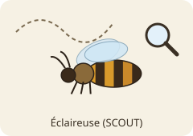
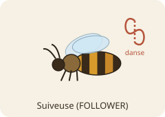
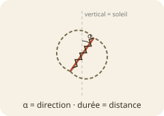
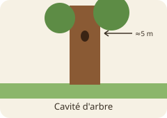
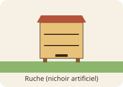
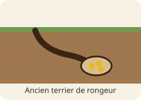
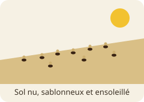
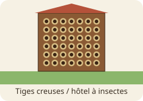
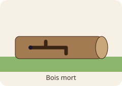

# Bzz : abeilles, rôles et habitats

Document récapitulatif du modèle actuel. Il regroupe les **rôles**, les **types d'habitats**, les
**caractéristiques d'un habitat** et la **personnalité** des abeilles.

> **État actuel.** Les abeilles sont génériques (pas d'espèce). Chacune a une **personnalité** et un **rôle**.
> **Les abeilles sont sans cerveau** : les rôles et leurs actions sont déclarés, mais aucune logique n'est implémentée.

```
Bee (Node2D)                  Habitat (Node2D)
  bee_name                      habitat_type, caractéristiques…
  personality: BeePersonality   capacity, occupants
  home: Habitat
  role: BeeRole.Id
  behavior: BeeBehavior
  set_role(id)
```

---

## 1. Rôles

Une abeille a **un rôle à la fois** : `FOLLOWER` par défaut. Elle peut en changer avec `set_role()`.
Le rôle est un composant (`bee.behavior`) qu'on remplace. Ce n'est pas une sous-classe de `Bee`.

| | Rôle | `BeeRole.Id` | Mission | Actions (fonctions) |
|---|---|---|---|---|
|  | Éclaireuse | `SCOUT` | chercher des habitats, les évaluer, les signaler par une danse | `explore()`, `evaluate(habitat)`, `go_back()`, `dance()` |
|  | Suiveuse | `FOLLOWER` | observer les danses, aller voir, juger l'habitat elle-même | `evaluation_signal_danse()`, `visit_habitat(habitat)`, `stay()`, `go_back_to_branch()` |

**Éclaireuse — `ScoutBehavior`**

| Action | Retour | Ce qu'elle fera |
|---|---|---|
| `explore()` | liste d'habitats | parcourir le monde à la recherche de sites candidats |
| `evaluate(habitat)` | score 0–1 | juger la qualité d'un site |
| `go_back()` | — | revenir à l'essaim |
| `dance()` | — | annoncer le site trouvé ; danse plus forte si le site est meilleur |

**Suiveuse — `FollowerBehavior`**

| Action | Retour | Ce qu'elle fera |
|---|---|---|
| `evaluation_signal_danse()` | score 0–1 | juger une danse observée |
| `visit_habitat(habitat)` | — | aller inspecter le site annoncé |
| `stay()` | — | s'installer sur le site visité |
| `go_back_to_branch()` | — | revenir à la branche de l'essaim |

🔬 **Biologie** (abeille mellifère). Les éclaireuses explorent puis dansent pour les sites trouvés. Les
suiveuses ne copient pas la danse : elles **vont voir le site elles-mêmes**. Quand assez d'abeilles sont sur
un même site (un *quorum*), l'essaim s'y envole (Seeley & Visscher 2004 ; Seeley 2010).



---

## 2. Types d'habitats

`Habitat.Type` a six valeurs :

| | Type | Description | Capacité typique |
|---|---|---|---|
|  | `TREE_CAVITY` | creux dans un tronc, entrée en hauteur | 1 colonie |
|  | `HIVE_BOX` | ruche ou nichoir artificiel | 1 colonie |
|  | `RODENT_BURROW` | ancien terrier de rongeur, souterrain | 1 colonie |
|  | `BARE_SOIL` | sol nu, sablonneux, ensoleillé | nombreux nids |
|  | `HOLLOW_STEM` | tiges creuses, hôtel à insectes | un nid par tube |
|  | `DEAD_WOOD` | tronc ou branche morte | quelques nids |

---

## 3. Caractéristiques d'un habitat

Chaque `Habitat` a ses propres valeurs. On peut en modifier certaines depuis le tableau de bord, dans les bornes ci-dessous.

| Attribut | Unité | Bornes | Signification |
|---|---|---|---|
| `habitat_type` | énumération | 6 types | type du site |
| `cavity_volume_l` | litres | 0 – 1000 | volume intérieur (≈ 0 pour un sol ou une tige) |
| `entrance_diameter_mm` | mm | 0 – 1000 | diamètre d'entrée (0 = sans objet) |
| `entrance_height_m` | m | 0 – 50 | hauteur de l'entrée au-dessus du sol |
| `sun_exposure` | 0–1 | 0 – 1 | ensoleillement |
| `humidity` | 0–1 | 0 – 1 | humidité |
| `floral_abundance` | 0–1 | 0 – 1 | fleurs à proximité |
| `predator_risk` | 0–1 | 0 – 1 | exposition aux prédateurs et parasites |
| `previously_occupied` | booléen | vrai / faux | ancien nid ou vieux rayons présents |
| `capacity` | entier | 1 – 1000 | combien d'abeilles ou colonies peuvent s'y installer |
| `occupants` | liste | — | abeilles qui y vivent (`is_full()`, `occupancy()`) |

**Valeurs par défaut par type (`HabitatCatalog`).**

`floral_abundance` vaut 0,6 pour tous les types.

| Type | Volume (L) | Entrée (mm) | Hauteur (m) | Soleil | Humidité | Prédateurs | Déjà occupé | Capacité |
|---|---|---|---|---|---|---|---|---|
| `TREE_CAVITY` | 40 | 40 | 5 | 0,4 | 0,4 | 0,2 | non | 1 |
| `HIVE_BOX` | 40 | 40 | 1 | 0,5 | 0,3 | 0,1 | non | 1 |
| `RODENT_BURROW` | 2 | 30 | 0 | 0,1 | 0,5 | 0,3 | oui | 1 |
| `BARE_SOIL` | 0 | 0 | 0 | 0,9 | 0,2 | 0,3 | non | 50 |
| `HOLLOW_STEM` | 0 | 7 | 1 | 0,8 | 0,3 | 0,2 | non | 20 |
| `DEAD_WOOD` | 0 | 0 | 1,5 | 0,7 | 0,2 | 0,2 | non | 5 |

La cavité d'arbre suit Seeley & Morse (1978) : environ 40 L, une entrée d'environ 12,5 cm², à environ 5 m de haut.
Les valeurs de soleil, d'humidité, de fleurs et de prédateurs sont des réglages de jeu.

---

## 4. Personnalité

Chaque abeille porte une `BeePersonality` : quatre traits entre 0 et 1. C'est une **invention de jeu** qui rend
chaque individu différent. Les traits n'ont **aucun effet pour l'instant**.

| Trait | Description | Effet prévu |
|---|---|---|
| `pickiness` (exigence) | difficulté sur la qualité d'un habitat | plus haut → il faut un meilleur score pour accepter |
| `boldness` (audace) | tolérance au risque | plus haut → le risque de prédateurs compte moins |
| `sociability` (sociabilité) | attrait pour les sites fréquentés | > 0,5 aime les sites occupés, < 0,5 les évite |
| `curiosity` (curiosité) | imprévisibilité | plus haut → jugements plus dispersés, choix moins prévisibles |

Sans personnalité fournie, une abeille reçoit des traits **aléatoires**.

### Profils prédéfinis (tableau de bord)

| Profil | Exigence | Audace | Sociabilité | Curiosité |
|---|---|---|---|---|
| prudente | 0,8 | 0,1 | 0,4 | 0,2 |
| audacieuse | 0,3 | 0,9 | 0,5 | 0,6 |
| sociable | 0,5 | 0,5 | 0,9 | 0,4 |
| curieuse | 0,4 | 0,6 | 0,5 | 0,9 |
| équilibrée | 0,5 | 0,5 | 0,5 | 0,5 |

---

## Sources

- Seeley, T. D. & Morse, R. A. (1978). *Nest site selection by the honey bee*. Insectes Sociaux 25, 323–337.
- Seeley, T. D. & Visscher, P. K. (2004). *Quorum sensing during nest-site selection by honeybee swarms*. Behavioral Ecology and Sociobiology 56, 594–601.
- Seeley, T. D. (2010). *Honeybee Democracy*. Princeton University Press.
