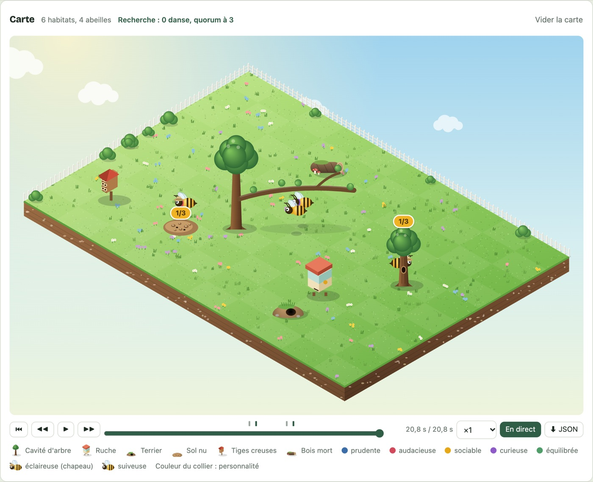
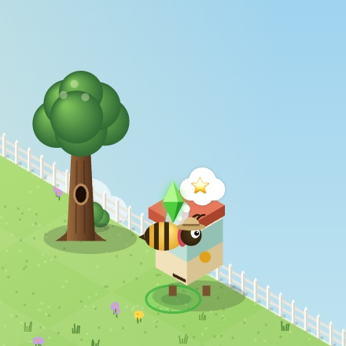

# Expérience utilisateur : la carte de Bzz

Notes de travail sur le dashboard ([`backend/bzz/static/index.html`](../backend/bzz/static/index.html)) :
ce qui est fait, ce qui coince, ce qu'on veut ajouter.

| Sujet | État |
|---|---|
| 1. Monde en isométrie 2D pseudo-3D | fait |
| 2. Difficultés des mondes déjà pré-faits | constat, choix fait |
| 3. Monstres et nourriture | à faire |
| 4. Menu pour configurer la carte | à faire |

## 1. Créer le monde en isométrie 2D pseudo-3D

**L'idée :** la simulation reste en 2D dans Godot (un rectangle de 1000 × 700). Seul le dashboard la dessine en
vue isométrique, comme une maquette posée sur la table, dans l'esprit des Sims.

**Comment c'est dessiné :**

- **Projection :** un point (x, y) du monde va à l'écran en
  `écran_x = (x − y) · cos 30°` et `écran_y = (x + y) / 2`. Le calcul inverse sert à glisser un objet à la souris.
- **Profondeur :** on dessine du fond vers l'avant, trié par `x + y`. Ce qui est devant cache ce qui est derrière.
- **Décor fixe** (ciel, pelouse en damier, palissade, bords en terre) : peint une seule fois, puis réutilisé à
  chaque image.
- **Tout est dessiné en code** (canvas), sans image à télécharger. Changer une couleur ou une taille prend une ligne.

**Ce qui rend la carte lisible et ludique :**

- **Le plumbob vert** au-dessus de l'élément sélectionné.
- **Une bulle de pensée** quand une abeille attend la LLM : ⭐ elle évalue un site, 👀 elle regarde les danses,
  🏠 elle hésite entre rester et repartir.
- **La danse frétillante :** l'abeille fait un huit et des notes ♪ montent. Une trace de miel relie la branche au site.
- **On reconnaît chaque abeille d'un coup d'œil :**
    - **son rôle :** l'éclaireuse porte un chapeau d'explorateur ;
    - **sa personnalité :** la couleur du collier.
- **Le quorum en pastille** au-dessus du site : 1/3, 2/3, puis ★ choisi.

**Limites actuelles :**

- **Pas de caméra :** on ne peut ni tourner ni zoomer.
- **Avec beaucoup d'abeilles,** la grappe sur la branche devient un amas difficile à lire.
- **Un grand arbre peut cacher une abeille** qui est derrière lui.
- **La fiche d'inspection** cache le côté droit de la carte quand elle est ouverte.
- **Pas testé sur téléphone.**

## 2. Les difficultés des mondes déjà pré-faits

Un monde pré-fait, c'est une carte dessinée à l'avance (un niveau, un pack d'assets, une tilemap) où tout est déjà
placé. On a choisi de **ne pas** partir de là. Voici pourquoi.

| Difficulté | Ce que ça donne dans Bzz |
|---|---|
| **Rigidité** | L'utilisateur veut choisir combien d'habitats, de quel type, puis déplacer. Une carte figée impose une disposition. |
| **Biais d'expérience** | Si les abeilles voient toujours la même carte, on mesure la carte, pas la décision collective. Il faut du placement aléatoire, rejouable avec une seed. |
| **Décor ≠ simulation** | Une mare dessinée sur une carte pré-faite n'existe pas pour Godot ni pour la LLM. L'utilisateur croit qu'elle compte, alors que non. Règle : **tout ce qu'on voit existe dans Godot, et inversement.** |
| **Styles qui ne collent pas** | Deux packs d'assets ont rarement le même angle, la même échelle et la même lumière. En isométrie, le moindre écart se voit tout de suite. |
| **Coordonnées** | Une tilemap a sa propre grille. Il faudrait traduire en permanence vers le monde Godot (1000 × 700). |
| **Évolution** | Ajouter monstres et nourriture voudrait dire redessiner la carte à la main. Avec des sprites en code, on ajoute un type. |
| **Licences** | Un pack d'assets téléchargé n'est pas toujours libre pour un projet publié. |

**Choix retenu :** un monde **composé**. L'utilisateur choisit les quantités, le placement est aléatoire, et chaque
objet peut ensuite être glissé à la main. Le décor (herbe, fleurs, palissade) reste purement visuel et n'a aucun effet.

## 3. Rajouter les monstres et la nourriture

Aujourd'hui, le danger et la nourriture ne sont que des **caractéristiques fixes d'un habitat** (`predator_risk`…).
On veut en faire des **objets sur la carte**, qui changent ce que les abeilles perçoivent.

**Monstres (prédateurs)**

| Monstre | Comportement sur la carte | Effet sur les abeilles |
|---|---|---|
| Frelon asiatique | Fait du sur-place devant un site, puis change de site | Le site devient « dangereux » tant qu'il est là |
| Guêpier (oiseau) | Patrouille sur une zone | Une abeille qui la traverse peut être perdue |
| Fourmis | Colonie fixe au sol | Les sites au ras du sol proches deviennent risqués |
| Blaireau / pic | Attaque un site de temps en temps | Le site peut être endommagé |

**Nourriture**

| Nourriture | Sur la carte | Effet |
|---|---|---|
| Champ de fleurs | Une zone colorée, qui fleurit puis fane | Un site proche est « riche en fleurs » |
| Arbre fruitier en fleur | Un arbre, en fleur une partie du temps | Pareil, mais seulement pendant la floraison |
| Point d'eau | Une petite mare | Un site proche a « de l'eau à côté » |

**Le principe reste le même :** la LLM ne voit pas les objets, elle voit des **mots**. Godot calcule la distance
d'un site aux monstres et à la nourriture, puis l'ajoute à `describe()`, par exemple « *safe* » → « *a hornet
nearby* », ou « *rich in flowers nearby* ». Le prompt et la méthode du jeton ne changent pas.

**Ce que ça demande :**

- **Godot :** deux nouveaux types d'entités (monstre, nourriture), leur déplacement, et les mots ajoutés dans `describe()`.
- **API :** les ajouter, les retirer et les déplacer, comme les habitats (validation dans `commands.py` et dans `WorldApi`).
- **Dashboard :** leurs sprites en isométrie. Un monstre aura aussi sa bulle (😠 quand il chasse).

**Points ouverts :**

- **Une abeille peut-elle mourir ?** Si oui, le quorum peut ne jamais être atteint. Il faudra alors une condition de fin.
- **Que faire si le monstre se déplace pendant qu'une abeille évalue un site ?** On garde la situation au moment où la
  question est posée.

## 4. Un menu pour configurer la carte

Aujourd'hui, le panneau de gauche ne gère que les habitats et les abeilles. On l'étend en un **menu en onglets**,
dans le même esprit : on choisit des quantités, on génère, puis on ajuste à la main.

<pre>
Composer la carte
  [Habitats]  [Abeilles]  [Nourriture]  [Monstres]

  Nourriture
    Champ de fleurs         [ − ]  3  [ + ]
    Arbre fruitier          [ − ]  1  [ + ]
    Point d'eau             [ − ]  1  [ + ]

  Monstres
    Frelon asiatique        [ − ]  1  [ + ]
    Guêpier                 [ − ]  0  [ + ]

  Total : 6 habitats, 5 abeilles, 5 nourritures, 1 monstre
                     [ Générer le monde ]
</pre>

**Règles d'usage :**

- **Un seul bouton pour créer :** « Générer le monde ». Le placement est aléatoire, sans chevauchement, et la
  branche de l'essaim reste au centre.
- **Tout se règle ensuite sur la carte :**
    - glisser un objet pour le déplacer ;
    - cliquer pour ouvrir sa fiche (caractéristiques d'un habitat, agressivité d'un monstre, quantité de fleurs) ;
    - « Retirer de la carte » pour l'enlever.
- **Les mêmes mots partout :** le menu, la fiche, la légende et le journal parlent de « champ de fleurs » et de « frelon ».
- **La légende** ajoute les nouveaux sprites, comme pour les habitats.
- **On n'ajoute que ce qui sert l'expérience :** pas de réglage décoratif, pas d'option sans effet sur la simulation.

**Ordre proposé :**

1. Nourriture : objets fixes, simples à brancher.
2. Monstres fixes.
3. Monstres qui bougent.
4. Condition de fin de simulation.
