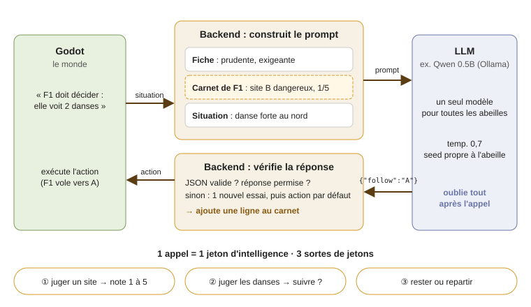

# Méthode : un jeton d'intelligence + un carnet

- **Un jeton = un appel LLM** pour une décision. Le modèle ne garde aucune mémoire entre deux appels.
- **Le carnet** de chaque abeille est gardé par le backend. Il contient ses dernières expériences et il est remis dans chaque prompt.
- **La fiche** (la personnalité) et **la situation** (les mots de `describe()`, les danses vues) complètent le prompt.
- **Godot** dit quand une abeille doit décider, puis exécute l'action. **La LLM ne touche jamais le monde.**
- La note d'un site sert aussi de force de danse : pas de jeton en plus pour danser.

Code : [`backend/bzz/brain.py`](../backend/bzz/brain.py).
