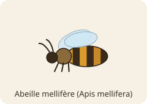
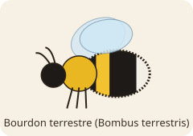
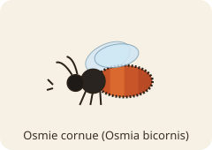
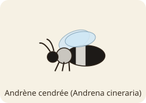
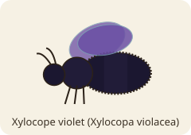

# Référence : abeilles et habitats

Document de conception du premier peuplement du monde Bzz. Il décrit les **types d'abeilles** envisagés,
les **habitats** qu'elles peuvent rechercher, les **critères** qui guident leur choix et les **traits de
personnalité** modélisés. Les classes correspondantes existent dans [`godot/entities/`](../godot/entities/), mais
**aucune abeille ni aucun habitat n'est encore instancié dans le monde simulé**.

Chaque section sépare :

- 🔬 **Biologie** : comportement réel, appuyé sur les sources listées en fin de document ;
- 🎮 **Simulation** : ce que le jeu en retient, et les simplifications introduites.

Les illustrations sont des schémas stylisés, pas des représentations anatomiques exactes.

---

## 1. Types d'abeilles

| | Espèce | Vie sociale | Habitats acceptés (simulation) |
|---|---|---|---|
|  | Abeille mellifère — *Apis mellifera* | colonie pérenne (essaim) | cavité d'arbre, ruche |
|  | Bourdon terrestre — *Bombus terrestris* | colonie annuelle (reine fondatrice) | terrier, ruche, cavité d'arbre |
|  | Osmie cornue — *Osmia bicornis* | solitaire | tiges creuses, bois mort |
|  | Andrène cendrée — *Andrena cineraria* | solitaire, souvent en bourgades | sol nu |
|  | Xylocope violet — *Xylocopa violacea* | solitaire | bois mort |

### 1.1 Abeille mellifère (*Apis mellifera*)


🔬 **Biologie.** Au printemps, une partie de la colonie part en essaim avec la reine. Des éclaireuses inspectent
les cavités disponibles, puis l'essaim choisit **collectivement** (danses de recrutement, quorum) ([Seeley 2010][seeley2010]).
Les expériences de Seeley & Morse ([1978][seeley1978]) montrent une préférence pour :

- une cavité d'environ **40 L** plutôt que 10 L ou 100 L (volume modal des nids naturels ≈ 35 L, [Seeley 1977][seeley1977]) ;
- une entrée de **12,5 cm²** plutôt que 75 cm² ;
- une entrée située **en bas** de la cavité, orientée **vers le sud** ;
- une entrée **haute (5 m)** plutôt que basse (1 m) ;
- une cavité ayant **déjà abrité une colonie** (vieux rayons) ; et un site à plus de 300 m de la colonie mère.

Les mêmes travaux n'ont **pas** trouvé de préférence pour la forme de l'entrée, la forme de la cavité,
les courants d'air ni l'humidité de la cavité.

🎮 **Simulation.** Préférences : volume 40 L (critère le plus lourd), entrée ≈ 40 mm de diamètre (≈ 12,5 cm²),
hauteur 5 m, cavité déjà occupée, fleurs à proximité. L'humidité n'est volontairement **pas** un critère.
*Simplifications* : le choix est fait par **une** abeille (pas de décision collective d'essaim, prévue plus tard) ;
l'orientation de l'entrée et la distance à la colonie mère ne sont pas modélisées.

### 1.2 Bourdon terrestre (*Bombus terrestris*)


🔬 **Biologie.** Au printemps, la reine fondatrice cherche seule un site de nid, en général **souterrain**,
souvent un **ancien nid de rongeur** dont elle réutilise le matériau isolant ([Wikipedia][bombus-wiki]).
Les espèces à nid souterrain, dont *B. terrestris*, sont associées aux **talus et haies**
([Kells & Goulson 2003][kells2003]). Elle accepte aussi des cavités au-dessus du sol et des nichoirs.

🎮 **Simulation.** Types acceptés : terrier, ruche, cavité d'arbre. Préférences : petite cavité (≈ 2 L),
entrée **au niveau du sol** (critère fort), humidité modérée, fleurs à proximité.
*Simplifications* : le volume « idéal » et la tolérance à l'humidité sont des **réglages de jeu**, non mesurés.

### 1.3 Osmie cornue (*Osmia bicornis*)


🔬 **Biologie.** Abeille solitaire qui niche dans des **cavités préexistantes** : tiges creuses, trous dans le bois,
fissures, nichoirs (« hôtels à insectes »). Les femelles construisent une file de cellules séparées par des
cloisons de boue ([Wikipedia][osmia-wiki]). Le diamètre de tube utilisable va d'environ **4 à 12 mm** ; au-delà,
les femelles construisent des rangées doubles ([étude pollinationecology][osmia-tubes]). Des diamètres de 6–8 mm sont
couramment recommandés en pratique.

🎮 **Simulation.** Types acceptés : tiges creuses, bois mort. Préférences : diamètre **7 mm** (± 5, critère fort),
plein soleil, entrée à environ 1 m du sol, fleurs à proximité.
*Simplifications* : la longueur du tube, le besoin en boue et le sex-ratio lié au diamètre sont ignorés.

### 1.4 Andrène (*Andrena*, ex. *A. cineraria*)


🔬 **Biologie.** Abeilles « minières » qui **creusent leur propre terrier** dans un **sol nu ou peu végétalisé,
bien drainé et ensoleillé** ([Ohio State Extension][andrena-osu]). Bien que solitaires, les femelles nichent souvent
en **bourgades** de dizaines d'entrées sur quelques m². Le couvert végétal et l'infiltration de l'eau sont
corrélés négativement au nombre de nids ([étude pollinationecology][ground-nesting]).

🎮 **Simulation.** Type accepté : sol nu. Préférences : plein soleil et **faible humidité** (critères forts), fleurs.
L'habitat « sol nu » a une **grande capacité** : plusieurs andrènes peuvent s'y installer, et la sociabilité
de chaque individu joue sur l'attrait d'un site déjà fréquenté.
*Simplifications* : texture du sol, pente et compacité ne sont pas modélisées.

### 1.5 Xylocope violet (*Xylocopa violacea*)


🔬 **Biologie.** Grande abeille solitaire qui **creuse des galeries** avec ses mandibules dans le **bois mort**
(troncs, branches, poutres), et utilise parfois des tiges creuses existantes. Les nids peuvent être ramifiés et
dépasser 80 cm ; les adultes hivernent dans les galeries
([revue PMC sur la nidification des Xylocopa][xylocopa-pmc]).

🎮 **Simulation.** Type accepté : bois mort. Préférences : bois ensoleillé et sec, fleurs.
*Simplifications* : la densité du bois et la réutilisation des galeries d'une année sur l'autre sont ignorées.

---

## 2. Types d'habitats

| | Type (`Habitat.Type`) | Description | Capacité typique |
|---|---|---|---|
|  | `TREE_CAVITY` | creux dans un tronc, entrée en hauteur | 1 colonie |
|  | `HIVE_BOX` | ruche ou nichoir artificiel | 1 colonie |
|  | `RODENT_BURROW` | ancien terrier de rongeur, souterrain | 1 colonie |
|  | `BARE_SOIL` | sol nu, sablonneux, ensoleillé | nombreux nids |
|  | `HOLLOW_STEM` | tiges creuses, hôtel à insectes | un nid par tube |
|  | `DEAD_WOOD` | tronc ou branche morte | quelques nids |

### Caractéristiques d'un habitat

Chaque instance de `Habitat` a ses propres valeurs :

| Attribut | Unité | Rôle |
|---|---|---|
| `habitat_type` | énumération | filtre : une espèce n'évalue que les types qu'elle accepte |
| `cavity_volume_l` | litres | volume intérieur (≈ 0 pour un sol ou une tige) |
| `entrance_diameter_mm` | mm | diamètre d'entrée (0 = sans objet) |
| `entrance_height_m` | m | hauteur de l'entrée au-dessus du sol |
| `sun_exposure` | 0–1 | ensoleillement |
| `humidity` | 0–1 | humidité |
| `floral_abundance` | 0–1 | ressources florales à proximité (pourra être calculé depuis le monde) |
| `predator_risk` | 0–1 | exposition aux prédateurs et parasites |
| `previously_occupied` | booléen | présence d'un ancien nid / de vieux rayons |
| `capacity`, `occupants` | entier, liste | combien d'abeilles ou colonies peuvent s'y installer, et qui y vit |

---

## 3. Critères de choix

Un **critère** (`Preference`) compare une caractéristique de l'habitat à une valeur idéale :

```
score = max(0, 1 − |valeur − idéal| / tolérance)        (1 à l'idéal, 0 au-delà de la tolérance)
```

Chaque espèce a sa liste de critères pondérés (`BeeSpecies.default_preferences`), copiée dans chaque abeille,
qui peut ensuite la modifier individuellement.

| Critère | Mellifère | Bourdon | Osmie | Andrène | Xylocope |
|---|---|---|---|---|---|
| Volume (L) | **40** ±35 (×2) | 2 ±4 | — | — | — |
| Diamètre d'entrée (mm) | 40 ±40 | — | **7** ±5 (×2) | — | — |
| Hauteur d'entrée (m) | 5 ±5 | **0** ±1 (×1,5) | 1 ±1,5 (×0,5) | — | — |
| Ensoleillement | — | — | 1 ±0,8 | **1** ±0,8 (×1,5) | 0,8 ±0,8 |
| Humidité | — *(non préférée, Seeley)* | 0,4 ±0,5 | — | **0,2** ±0,6 (×1,5) | 0,2 ±0,6 |
| Ancien nid | 1 ±1 (×0,5) | — | — | — | — |
| Fleurs à proximité | 1 ±1 | 1 ±1 | 1 ±1 | 1 ±1 | 1 ±1 |

Les **valeurs idéales** viennent des sources quand elles existent (mellifère, diamètre des osmies) ;
les **tolérances et poids** sont des réglages de jeu.

---

## 4. Personnalité

🔬 **Biologie.** Des différences individuelles stables existent chez l'abeille mellifère : certaines ouvrières
sont bien plus portées que d'autres à explorer et à devenir éclaireuses, avec des signatures moléculaires
associées (Liang et al. 2012). Pour les autres espèces, ces différences sont peu documentées.

🎮 **Simulation.** Chaque abeille porte une `BeePersonality` avec quatre traits entre 0 et 1. C'est une
**invention de jeu** destinée à rendre les individus distincts ; elle ne prétend pas décrire une réalité biologique.

| Trait | Effet sur le choix |
|---|---|
| `pickiness` (exigence) | seuil d'acceptation = 0,3 + 0,5 × exigence ; en dessous, l'abeille ne choisit rien |
| `boldness` (audace) | pénalité de risque = `predator_risk` × (1 − audace) |
| `sociability` (sociabilité) | sur un habitat à plusieurs places : bonus (> 0,5) ou malus (< 0,5) proportionnel au taux d'occupation |
| `curiosity` (curiosité) | bruit aléatoire ±0,1 × curiosité sur chaque évaluation : choix moins prévisibles |

---

## 5. Modèle logiciel

Classes GDScript dans [`godot/entities/`](../godot/entities/) :

```
BeeSpecies (catalogue)        Bee (Node2D)                       Habitat (Node2D)
  Id: 5 espèces          ──►    species, bee_name                   habitat_type, caractéristiques…
  accepted_types(id)            accepted_types                      capacity, occupants
  default_preferences(id)       preferences: [Preference]           features() -> {critère: valeur}
                                personality: BeePersonality         is_full(), occupancy()
                                home: Habitat
                                score_breakdown(h) / evaluate_habitat(h)
                                choose_habitat([h…]) -> Habitat | null
                                settle(h), leave_home()
                                role: BeeRole.Id, behavior: BeeBehavior, set_role(id)
```

Évaluation d'un habitat par une abeille (`Bee.score_breakdown`) :

1. type non accepté, ou habitat plein (et pas son propre logis) → **0** ;
2. moyenne pondérée des scores de critères ;
3. × (1 − risque × (1 − audace)) ;
4. \+ effet de sociabilité si l'habitat a plusieurs places ;
5. \+ bruit de curiosité, puis borné entre 0 et 1.

`choose_habitat` retient le meilleur candidat dont le score atteint le seuil d'exigence.
Chaque abeille a son propre générateur aléatoire (graine optionnelle via `Bee.create(espèce, personnalité, graine)`),
ses propres copies de préférences et sa propre personnalité : les instances sont indépendantes.

Tests : [`godot/tests/test_entities.gd`](../godot/tests/test_entities.gd), lancé par `backend/tests/test_entities.py`.

### Rôles

Chaque abeille porte un **rôle** (`SCOUT` éclaireuse, `FOLLOWER` suiveuse, `QUEEN` reine), indépendant de son
espèce et de sa personnalité, et un composant de comportement qui déclare les actions de ce rôle
(classes dans [`godot/entities/roles/`](../godot/entities/roles/)). Ces actions ne sont encore que des interfaces :
voir le document dédié [Rôles et comportements](roles_comportements.md).

---

## Sources

- <a id="s1"></a>Seeley, T. D. & Morse, R. A. (1978). *Nest site selection by the honey bee, Apis mellifera*. Insectes Sociaux 25, 323–337. [doi:10.1007/BF02224297][seeley1978]
- Seeley, T. D. (1977). *Measurement of nest cavity volume by the honey bee*. [PDF][seeley1977]
- Seeley, T. D. (2010). *Honeybee Democracy*. Princeton University Press. (présentation : [Science Friday][seeley2010])
- *Bombus terrestris*, Wikipedia. [lien][bombus-wiki]
- Kells, A. R. & Goulson, D. (2003). *Preferred nesting sites of bumblebee queens in agroecosystems in the UK*. Biological Conservation 109, 165–174. [dépôt Stirling][kells2003]
- *Osmia bicornis*, Wikipedia. [lien][osmia-wiki]
- Étude des dimensions de tubes de nidification d'*O. bicornis*, Journal of Pollination Ecology. [lien][osmia-tubes]
- Ohio State University Extension, *Mining bees*. [lien][andrena-osu]
- Étude sur les abeilles nichant au sol (couvert végétal, drainage), Journal of Pollination Ecology. [lien][ground-nesting]
- Revue sur la nidification des *Xylocopa*, PMC. [lien][xylocopa-pmc]
- Liang, Z. S. et al. (2012). *Molecular determinants of scouting behavior in honey bees*. Science 335, 1225–1228.

[seeley1978]: https://dx.doi.org/10.1007/BF02224297
[seeley1977]: https://www.shoalsmarinelaboratory.org/sites/default/files/media/2026-02/Seeley%201977_SML75.pdf
[seeley2010]: https://www.sciencefriday.com/articles/how-do-bees-find-a-home/
[bombus-wiki]: https://en.wikipedia.org/wiki/Bombus_terrestris
[kells2003]: https://dspace.stir.ac.uk/handle/1893/7294
[osmia-wiki]: https://en.wikipedia.org/wiki/Osmia_bicornis
[osmia-tubes]: https://pollinationecology.org/index.php/jpe/article/view/697
[andrena-osu]: https://u.osu.edu/knoxcountyag/?p=3714
[ground-nesting]: https://pollinationecology.org/index.php/jpe/article/download/682/368/3638
[xylocopa-pmc]: https://pmc.ncbi.nlm.nih.gov/articles/PMC7347186
