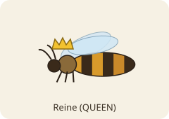
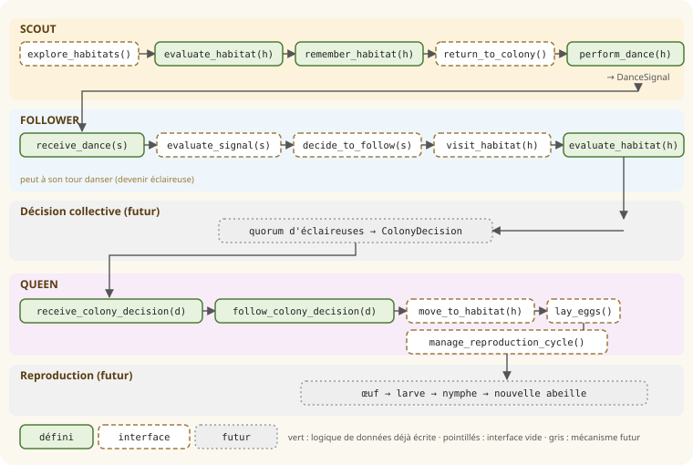
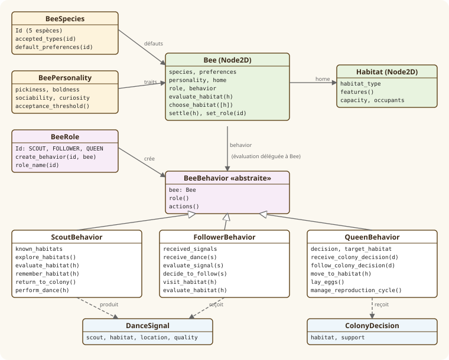

# Rôles et comportements des abeilles

Document de conception des **rôles** (éclaireuse, suiveuse, reine) et des **actions** que chaque rôle pourra
accomplir. Il complète la [référence abeilles et habitats](reference_abeilles.md).

> **État actuel.** Les classes et leurs interfaces existent dans [`godot/entities/roles/`](../godot/entities/roles/).
> Des abeilles (avec leur rôle) et des habitats peuvent être placés dans le monde depuis le tableau de bord, mais
> **aucune action de rôle n'est exécutée** et aucune colonie n'existe.
> Les méthodes marquées *interface* sont vides : elles ne déplacent rien, ne créent pas d'œufs et ne génèrent pas
> de nouvelles abeilles.

Comme dans la référence, on distingue :

- 🔬 **Biologie** : comportement réel, sourcé ;
- 🎮 **Simulation** : ce que le logiciel prévoit, et les simplifications.

---

## 1. Les trois rôles

| | Rôle | `BeeRole.Id` | Mission |
|---|---|---|---|
|  | Éclaireuse | `SCOUT` | chercher des habitats, les évaluer, les signaler par une danse |
|  | Suiveuse | `FOLLOWER` | observer les danses, décider d'aller voir, juger l'habitat elle-même |
|  | Reine | `QUEEN` | suivre la décision collective, pondre, assurer la reproduction |

🔬 **Biologie.** Ce découpage vient de l'essaimage de l'abeille mellifère. Lorsqu'un essaim quitte la colonie,
seule une petite partie des ouvrières part en exploration : ce sont les **éclaireuses**. De retour sur l'essaim,
elles annoncent les sites trouvés par une **danse frétillante**. D'autres abeilles suivent ces danses, vont
**inspecter le site elles-mêmes** et, si elles l'approuvent, dansent à leur tour pour lui. Lorsqu'un
**nombre suffisant d'éclaireuses** (un *quorum*) se trouve en même temps sur un même site, l'essaim se prépare
au départ (signaux de « piping ») puis s'envole vers ce site ([Seeley & Visscher 2004][quorum];
[Visscher & Seeley 2007][visscher2007]). **La reine ne participe pas au choix** : elle accompagne l'essaim.

🎮 **Simulation.** Les rôles sont **indépendants des espèces** : les cinq espèces du catalogue peuvent recevoir les
trois rôles, avec exactement la même interface. *Simplification assumée* : chez les bourdons et les abeilles
solitaires, il n'y a ni danse ni décision collective ; ces espèces pourront simplement ne pas utiliser
certains rôles. Une abeille a **un rôle à la fois**, `FOLLOWER` par défaut, et peut en changer (`set_role`).

---

## 2. Éclaireuse — `SCOUT`

🔬 **Biologie.** L'éclaireuse inspecte une cavité (volume, entrée, hauteur…) puis revient danser. La **force de sa
danse** (nombre de circuits frétillants) **augmente avec la qualité du site** ([Seeley & Buhrman 2001][buhrman];
[J. Exp. Biol. 2008][jeb2008]). Avec le temps, elle danse de moins en moins pour ce site puis s'arrête
(« attrition »), ce qui permet aux bons sites, soutenus par de nouvelles recrues, de l'emporter. Les abeilles
peuvent aussi émettre un **signal stop** (coup de tête) contre les danseuses d'un site concurrent.

🎮 **Simulation** — classe `ScoutBehavior` :

| Action | Statut | Rôle |
|---|---|---|
| `explore_habitats() -> Array[Habitat]` | interface | rechercher les habitats disponibles (renvoie une liste vide) |
| `evaluate_habitat(h) -> float` | **défini** | délègue à `Bee.evaluate_habitat` (préférences + personnalité) |
| `remember_habitat(h)` | **défini** | mémorise l'habitat et sa note dans `known_habitats` |
| `return_to_colony()` | interface | retour vers la colonie (aucun déplacement) |
| `perform_dance(h) -> DanceSignal` | **défini** | prépare le signal de danse (donnée seule, rien n'est diffusé) |

`DanceSignal` porte : l'éclaireuse (`scout`), l'habitat, sa position (`location`), la qualité estimée
(`quality`, 0–1) et l'instant de création. *Simplifications* : la position est donnée directement au lieu d'être
codée en angle et durée ; la force de la danse, l'attrition et le signal stop sont laissés au futur
mécanisme de décision collective.

---

## 3. Suiveuse — `FOLLOWER`

🔬 **Biologie.** Une abeille recrutée par une danse ne copie pas l'avis de la danseuse : elle **va inspecter le
site elle-même** et ne danse pour lui que si elle le juge bon. Ce contrôle indépendant est une raison pour
laquelle l'essaim choisit le plus souvent le meilleur site disponible ([Seeley 2010][seeley2010]).

🎮 **Simulation** — classe `FollowerBehavior` :

| Action | Statut | Rôle |
|---|---|---|
| `receive_dance(s)` | **défini** | enregistre la danse observée dans `received_signals` |
| `evaluate_signal(s) -> float` | interface | analysera la danse (qualité, distance, éclaireuse) ; renvoie 0 |
| `decide_to_follow(s) -> bool` | interface | décidera si la danse justifie un déplacement ; renvoie `false` |
| `visit_habitat(h)` | interface | visite de l'habitat indiqué (aucun déplacement) |
| `evaluate_habitat(h) -> float` | **défini** | jugement indépendant, mêmes règles que l'éclaireuse (délégué à `Bee`) |

Une suiveuse convaincue pourra **devenir éclaireuse** (`set_role(SCOUT)`) et danser à son tour.

---

## 4. Reine — `QUEEN`

🔬 **Biologie.** La reine ne choisit pas le site : elle suit l'essaim. Installée, elle pond ; le développement de
l'œuf à l'adulte dure en moyenne **16 jours pour une reine, 21 pour une ouvrière et 24 pour un mâle**
(valeurs couramment citées, [Bee Professor][lifecycle]).

🎮 **Simulation** — classe `QueenBehavior`. La reine **n'a aucune méthode d'évaluation ni de choix d'habitat** :
c'est vérifié par les tests.

| Action | Statut | Rôle |
|---|---|---|
| `receive_colony_decision(d)` | **défini** | enregistre la `ColonyDecision` reçue |
| `follow_colony_decision(d)` | **défini** | adopte l'habitat décidé comme destination (`target_habitat`), sans bouger |
| `move_to_habitat(h)` | interface | déplacement vers l'habitat retenu (aucun déplacement) |
| `lay_eggs()` | interface | ponte (ne crée rien) |
| `manage_reproduction_cycle()` | interface | cycle de reproduction et développement des nouvelles abeilles (ne crée rien) |

`ColonyDecision` est le **contrat de données** entre le futur mécanisme de décision collective et la reine :
l'habitat retenu (`habitat`) et son soutien (`support`, par exemple le nombre d'éclaireuses au quorum).

---

## 5. Enchaînement prévu

Le schéma montre comment les actions s'enchaîneront lorsque les mécanismes seront écrits.
En **vert**, la logique de données déjà écrite ; en **pointillés**, les interfaces vides ; en **gris**, les
mécanismes futurs qui n'existent pas encore.

---

## 6. Architecture et séparation des responsabilités

Règles retenues :

- **Pas de duplication de l'évaluation** : éclaireuse et suiveuse appellent `Bee.evaluate_habitat`.
- **Rôles sans restriction d'espèce** : `BeeRole` ne connaît pas `BeeSpecies`.
- **Composition** : le rôle est un composant (`bee.behavior`) qu'on remplace, pas une sous-classe de `Bee` ;
  une abeille peut donc changer de rôle sans être recréée.
- `BeeBehavior` est une **classe abstraite** (`@abstract`, Godot ≥ 4.5) : chaque rôle doit déclarer `role()` et `actions()`.

| Élément | Responsabilité | Où |
|---|---|---|
| `BeeSpecies` | caractéristiques et préférences par défaut de l'espèce | `entities/bee_species.gd` |
| `BeePersonality` | traits individuels et tendances | `entities/bee_personality.gd` |
| `BeeRole` | liste des rôles, création du composant de comportement | `entities/roles/bee_role.gd` |
| `BeeBehavior` (abstraite) et ses sous-classes | interfaces des actions de chaque rôle | `entities/roles/*_behavior.gd` |
| `Bee` | porte espèce, personnalité, rôle ; **seule** à évaluer un habitat | `entities/bee.gd` |
| `DanceSignal`, `ColonyDecision` | données échangées entre rôles | `entities/roles/` |
| Décision collective | choisir l'habitat de la colonie (quorum) | **à créer** |
| Reproduction | ponte, développement, naissance | **à créer** |

---

## 7. Reste à implémenter

| Comportement | Méthode(s) concernée(s) |
|---|---|
| Recherche d'habitats dans le monde | `ScoutBehavior.explore_habitats` |
| Déplacements (aller, retour, visite, déménagement) | `return_to_colony`, `visit_habitat`, `move_to_habitat` |
| Analyse d'une danse et décision de la suivre | `evaluate_signal`, `decide_to_follow` |
| Décision collective (force de danse, attrition, signal stop, quorum) | nouveau mécanisme → produit `ColonyDecision` |
| Ponte et cycle de reproduction | `lay_eggs`, `manage_reproduction_cycle` + nouveau mécanisme |
| Commandes Python pour piloter rôles et entités | protocole `godot/main.gd` + `backend/bzz/commands.py` |

---

## Sources

- Seeley, T. D. & Visscher, P. K. (2004). *Quorum sensing during nest-site selection by honeybee swarms*. Behavioral Ecology and Sociobiology 56, 594–601. [doi:10.1007/s00265-003-0664-6][quorum]
- Visscher, P. K. & Seeley, T. D. (2007). *Coordinating a group departure: who produces the piping signals on honeybee swarms?* [PDF][visscher2007]
- Seeley, T. D. & Buhrman, S. C. (2001). *Nest-site selection in honey bees: how well do swarms implement the "best-of-N" decision rule?* [PDF][buhrman]
- *Sensory coding of nest site value in honeybee swarms*, Journal of Experimental Biology 211 (2008). [lien][jeb2008]
- Seeley, T. D. (2010). *Honeybee Democracy*. Princeton University Press. (présentation : [Science Friday][seeley2010])
- *Lifecycle of a honey bee*, Bee Professor (durées de développement). [lien][lifecycle]

[quorum]: https://www.doi.org/10.1007/S00265-003-0664-6
[visscher2007]: https://www.shoalsmarinelaboratory.org/sites/default/files/media/2026-02/Visscher%26Seeley%202007_SML136.pdf
[buhrman]: https://www.shoalsmarinelaboratory.org/sites/default/files/media/2026-02/Seeley%26Buhrman%202001_SML105.pdf
[jeb2008]: https://cob.silverchair.com/jeb/article/211/23/3691/17956/Sensory-coding-of-nest-site-value-in-honeybee
[seeley2010]: https://www.sciencefriday.com/articles/how-do-bees-find-a-home/
[lifecycle]: https://beeprofessor.com/lifecycle-of-a-honey-bee/
